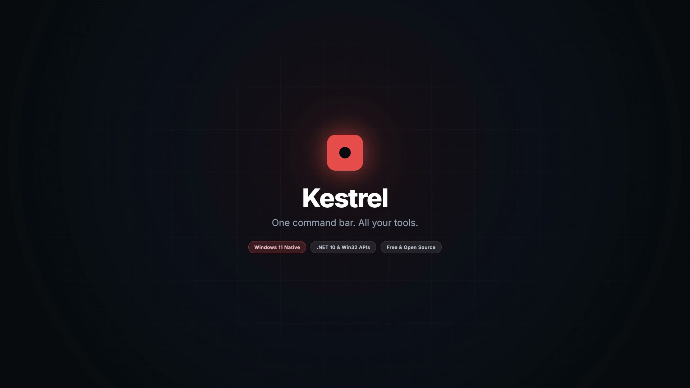
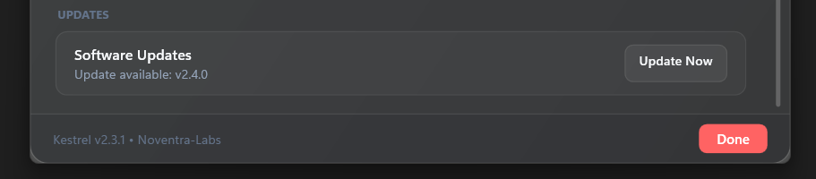

  

  <strong>The ultra-fast, minimalist command bar for Windows 11.</strong> 
  Instant app search, clipboard history, one-click RAM cleaner, AI assistant, and desktop tools in a beautiful native bar.

  
  
  
  

---

## ⚡ What is Kestrel?

**Kestrel** is a fast, lightweight command bar designed specifically for Windows 11 and Windows 10. 

Instead of waiting for sluggish Windows Start Menu searches, web ads, or juggling 5 different background utilities, Kestrel puts everything you need into one clean omnibar. Tap your **`Win`** key or press **`Alt` + `Space`**, type what you want, and hit **`Enter`**.

  

---

## 📥 Download Kestrel

Choose the edition that best fits how you work:

| Edition | Size | What's Included | Download |
| :--- | :--- | :--- | :--- |
| **Windows Installer** (`Kestrel-Setup.exe`) | **~27.8 MB** | **Recommended.** Guided setup wizard, automatic updates, Start Menu & Desktop shortcuts, optional auto-start with Windows, and clean uninstaller in Windows Settings. | [⬇️ **Download Installer (.exe)**](https://github.com/Noventra-Labs/Kestrel/releases/download/v2.3.1/Kestrel-Setup.exe) |
| **Portable Edition** (`Kestrel.exe`) | **~26.6 MB** | Single standalone `.exe`. No installation required — run directly from your Downloads folder, desktop, or a USB thumb drive without modifying Windows system files. | [📦 **Download Portable (.exe)**](https://github.com/Noventra-Labs/Kestrel/releases/download/v2.3.1/Kestrel.exe) |

> [!NOTE]
> All releases, release notes, and file checksums are available on the [**Official GitHub Releases Page**](https://github.com/Noventra-Labs/Kestrel/releases).

### System Requirements
- **Operating System:** Windows 11 (all versions: 21H2, 22H2, 23H2, 24H2) or Windows 10 (22H2+) 64-bit (`x64`).
- **Dependencies:** None! Everything is bundled inside the executable — no need to install .NET or extra frameworks.
- **Permissions:** Standard user mode works for search and tools; Administrator privileges enable deep kernel memory cleanup and single Windows Key interception.

---

## 🚀 Getting Started in 30 Seconds

1. **Download & Launch:** Run `Kestrel-Setup.exe` (or open the portable `Kestrel.exe`).
2. **Summon the Bar:** Tap your **`Win`** key or press **`Alt` + `Space`** from any screen or app.
3. **Type & Execute:**
   - Type an app name (e.g. `code`, `chrome`, `spotify`) and press <kbd>Enter</kbd> to launch.
   - Type `ram` and press <kbd>Enter</kbd> to instantly free gigabytes of locked system memory.
   - Type `clip` to view and paste recent copied text, links, or colors.
   - Type `ai` to ask Gemini, ChatGPT, or Claude a question without opening your browser.
4. **Dismiss:** Press <kbd>Esc</kbd> whenever you want to close the bar.

---

## ✨ Features You’ll Use Every Day

  

### 🔍 Instant App & File Search
- **Zero Input Lag:** Results appear under 5 milliseconds — before your finger even lifts from the key.
- **Fuzzy Search:** You don't need exact spelling. Type `ps` for PowerShell, `term` for Windows Terminal, or `calc` for Calculator.
- **No Sponsored Junk:** Pure local search with zero Bing web search suggestions, trending news, or web advertisements.

### 🧹 1-Click Memory Cleaner (RAM Reduct)
- Windows often leaves gigabytes of closed apps lingering in the Standby memory cache.
- Kestrel directly frees cached and standby memory with one tap, instantly returning RAM to heavy games, IDEs, or video editors without rebooting.

### 📋 Encrypted Clipboard History
- Never lose a copied snippet, password token, link, or image URL again.
- Filter through your past clipboard items and paste them back in either formatted or clean plain text.
- Secured and encrypted locally on your computer with Windows DPAPI.

### 🤖 Desktop AI Assistant
- Chat directly with AI models (**Google Gemini**, **OpenAI ChatGPT**, or **Anthropic Claude**) straight from the command bar.
- Write a quick email draft, ask for a regex pattern, convert code, or ask questions without switching away from your current workspace.

### 🎯 Screen Text Extractor (OCR)
- Need to copy text from an image, YouTube video, Zoom presentation, or an unselectable Windows error dialog?
- Trigger the **Text Extractor**, drag a box over any part of your screen, and the text is instantly copied to your clipboard.

### 🎨 Precision Color Eyedropper
- Click the eyedropper, hover over any pixel on your monitor with a live zoom magnifier, and click to grab the exact color.
- Automatically copies the color in **HEX** (`#ff6363`), **RGB**, or **OKLCH**.

### 🛠️ Everyday Quick Utilities
- **UUID / GUID Generator:** Instantly generate clean unique IDs.
- **Base64 Encoder & Decoder:** Fast text encoding without suspicious online converter websites.
- **JSON Formatter:** Prettify and validate messy JSON strings.
- **Epoch / Timestamp Converter:** Convert Unix timestamps to human-readable dates in real time.
- **Hashes:** Generate MD5, SHA-1, and SHA-256 hashes on the fly.

### 📌 Window Controls & Keep Awake
- **Always on Top:** Pin reference documents, calculator windows, or video calls so they never get hidden behind other apps.
- **Keep Awake:** Prevent your PC from sleeping or locking the screen during long downloads, renders, or presentations with a single switch.

---

## ⌨️ Keyboard Shortcuts Reference

| Shortcut | Description |
| :--- | :--- |
| <kbd>Win</kbd> or <kbd>Alt</kbd> + <kbd>Space</kbd> | Summon or dismiss the Kestrel command bar |
| <kbd>↑</kbd> / <kbd>↓</kbd> | Navigate up and down through search results |
| <kbd>Enter</kbd> | Execute selected action, launch app, or copy item |
| <kbd>Ctrl</kbd> + <kbd>Shift</kbd> + <kbd>Enter</kbd> | Launch selected app or terminal **as Administrator** |
| <kbd>Esc</kbd> | Clear your search text, or close Kestrel if already empty |
| <kbd>Tab</kbd> / <kbd>Shift</kbd> + <kbd>Tab</kbd> | Cycle through category tabs: `All`, `Apps`, `Utilities`, `Clipboard`, `AI`, `Developer` |
| <kbd>Ctrl</kbd> + <kbd>,</kbd> | Open Kestrel Preferences & Settings |

---

## ⚙️ Customization & Settings

Open **Settings** by right-clicking the Kestrel bird icon in your Windows System Tray (bottom-right taskbar) or typing `settings` in Kestrel:

- **Summon Hotkey:** Choose between single **`Win`** key, **`Alt` + `Space`**, **`Ctrl` + `Space`**, or configure your own favorite key combo.
- **Appearance:** Toggle between Windows 11 Acrylic frosted glass, Mica, or solid dark mode.
- **Startup:** Toggle **Run on Windows Startup** to have Kestrel ready whenever you turn on your PC.
- **AI Configuration:** Add your personal API key for Google Gemini, OpenAI, or Claude. Keys are stored safely in Windows Credential Manager.

---

## 🏆 How Kestrel Compares

| Feature | Kestrel | Windows Start Menu | PowerToys Run | Other Launchers |
| :--- | :---: | :---: | :---: | :---: |
| **Search Speed** | **Instant (< 5ms)** | 400ms – 1200ms | ~280ms | 200ms – 500ms |
| **Memory Usage** | **~48 MB** | Built-in Windows | ~320 MB | 250 MB – 500 MB+ |
| **Memory Cleaner** | **Built-in (1-Click)** | ❌ No | ❌ No | ❌ No |
| **Clipboard History** | **Built-in & Encrypted** | Basic (<kbd>Win</kbd>+<kbd>V</kbd>) | ❌ No | Plugins required |
| **Web Ads & Sponsored Apps** | **Zero (Never)** | Yes (Bing / News) | No | Sometimes |
| **Screen OCR & Eyedropper** | **Built-in** | ❌ No | Separate tools | ❌ No |
| **Desktop AI Assistant** | **Built-in** | Web link only | ❌ No | Plugins required |

---

## ❓ Frequently Asked Questions (FAQ)

<strong>Windows SmartScreen shows "Windows protected your PC". Is Kestrel safe?</strong>

**Yes, Kestrel is 100% safe, open-source, and free.**  
Because Kestrel is an independent open-source project and newly released binaries do not yet have expensive corporate EV signing certificates, Windows SmartScreen may show an alert on first launch.  
Simply click **More info** and then click **Run anyway**. You can review the entire public source code on GitHub.

<strong>Why does Kestrel benefit from Administrator privileges?</strong>

While Kestrel runs happily as a standard app, running as Administrator lets it:
1. Intercept the single `Win` key cleanly without opening the default Windows Start Menu.
2. Purge Standby memory lists at the Windows kernel level to free up locked RAM.
3. Launch other apps as Administrator via <kbd>Ctrl</kbd> + <kbd>Shift</kbd> + <kbd>Enter</kbd>.

<strong>Where does Kestrel run when I'm not using it?</strong>

Kestrel stays quietly in your Windows System Tray (near the clock in your taskbar). It uses near-zero CPU and only ~48 MB of RAM when idle.

<strong>How do I close or uninstall Kestrel?</strong>

- **To exit:** Right-click the Kestrel tray icon in the taskbar and click **Exit Kestrel**.
- **To uninstall:** If you used the installer, go to **Windows Settings > Apps > Installed apps**, find **Kestrel**, and click **Uninstall**. If you used the portable version, just delete the `Kestrel.exe` file.

---

## 🛡️ Privacy & Offline First

- **Zero Tracking:** No telemetry, analytics, user profiling, or background tracking.
- **Offline First:** All search indexing, clipboard management, memory cleaning, and utilities run 100% locally on your computer without an internet connection.
- **Your Data Stays Yours:** Internet connections only happen if you explicitly configure an AI assistant API key and ask a question.

---

## 📄 License & Credits

Developed with precision by [**Noventra-Labs**](https://github.com/Noventra-Labs).  
Licensed under the open-source **[MIT License](LICENSE)**.

---

**Kestrel — One command bar. All your tools.**
