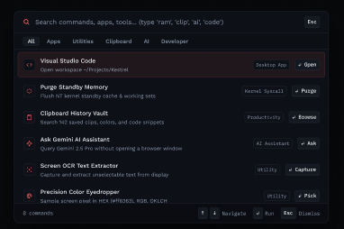

<p align="center">
  
</p>

<p align="center">
  <strong>An ultra-fast, native command bar and productivity omnibar for Windows 11.</strong><br />
  Instant search, clipboard history, kernel RAM cleaner, AI assistant, and developer utilities in a lightweight native shell.
</p>

<p align="center">
  <a href="https://github.com/Noventra-Labs/Kestrel/releases/tag/v2.3.1"></a>
  <a href="https://www.microsoft.com/windows"></a>
  <a href="https://dotnet.microsoft.com/"></a>
  <a href="LICENSE"></a>
  
  
</p>

---

## ⚡ Overview

**Kestrel** is engineered by **Noventra-Labs** for developers, systems engineers, and workflow power users who demand instant keyboard execution without sluggish Start Menu indexing, telemetry, or web advertisements.

Summoned with a single tap of the **`Win`** key or **`Alt` + `Space`**, Kestrel replaces half a dozen background utilities with one hyper-optimized, native Windows application.

<p align="center">
  
</p>

---

## 📥 Download & Installation

Choose between the automated setup installer or the standalone portable executable:

| Distribution | Size | Description | Download Link |
| :--- | :--- | :--- | :--- |
| **Windows Installer** (`Kestrel-Setup.exe`) | **~27.8 MB** | Recommended for most users. Includes setup wizard, Start Menu & Desktop shortcuts, automatic startup option, and clean Windows Add/Remove Programs registration. | [**Download Installer**](https://github.com/Noventra-Labs/Kestrel/releases/download/v2.3.1/Kestrel-Setup.exe) |
| **Portable Executable** (`Kestrel.exe`) | **~26.6 MB** | Zero installation required. Self-contained single `.exe` that runs directly from any folder or USB flash drive without touching system registries. | [**Download Portable**](https://github.com/Noventra-Labs/Kestrel/releases/download/v2.3.1/Kestrel.exe) |

> [!TIP]
> You can also browse all release assets, checksums, and changelogs on the [**Official GitHub Releases Page**](https://github.com/Noventra-Labs/Kestrel/releases).

### System Requirements

- **Operating System:** Windows 11 (21H2, 22H2, 23H2, 24H2) or Windows 10 (22H2+) 64-bit (`x64`).
- **Runtime:** Fully self-contained — no external .NET runtime installation required.
- **Privileges:** Administrator privileges recommended to enable direct NT kernel memory purging and single Windows Key defusal.

---

## 🚀 How to Use Kestrel

### 1. Summoning the Command Bar

Kestrel stays quietly tucked in your Windows system tray until called:

- Press **`Win`** (single tap) or **`Alt` + `Space`** from anywhere on your desktop to summon the omnibar.
- Press **`Esc`** at any time to instantly dismiss the bar.

### 2. Keyboard Navigation & Shortcuts

| Shortcut | Action |
| :--- | :--- |
| <kbd>Win</kbd> or <kbd>Alt</kbd> + <kbd>Space</kbd> | Summon or dismiss Kestrel Command Bar |
| <kbd>↑</kbd> / <kbd>↓</kbd> | Navigate up and down through search results |
| <kbd>Enter</kbd> | Execute selected action, launch app, or copy result |
| <kbd>Ctrl</kbd> + <kbd>Shift</kbd> + <kbd>Enter</kbd> | Run selected application or shell command **as Administrator** |
| <kbd>Esc</kbd> | Clear search query, or close Kestrel if query is empty |
| <kbd>Tab</kbd> / <kbd>Shift</kbd> + <kbd>Tab</kbd> | Cycle through category filter chips (`All`, `Apps`, `Utilities`, `Clipboard`, `AI`, `Developer`) |

---

## ✨ Key Features & Capabilities

<p align="center">
  
</p>

### 🔍 Instant App & File Search
- **Sub-5ms Keystroke Latency:** Direct index traversal of installed applications, Windows Control Panel applets, and system utilities.
- **Fuzzy Search:** Type partial keywords (e.g., `code`, `term`, `calc`, `powershell`) to instantly match tools without exact spelling.
- **Zero Web Ads:** Completely bypasses Microsoft Bing web searches and sponsored recommendations.

### 🧹 Kernel-Level Standby RAM Sweeper
- Reclaim gigabytes of memory locked by Windows 11 Standby lists without rebooting.
- Direct NT kernel syscall invocation (`NtSetSystemInformation`) flushes working sets and purges standby pages on demand.
- Real-time memory telemetry shows free, standby, and active memory pools directly in the launcher.

### 📋 Encrypted Clipboard History Vault
- Automatically captures text, hyperlinks, code snippets, and color codes as you copy them.
- Encrypted locally at rest using Windows DPAPI (Data Protection API).
- Search past clips instantly and paste back in formatted or clean plain text.

### 🤖 Desktop AI Assistant
- Integrated AI query bar supporting **Google Gemini**, **Anthropic Claude**, and **OpenAI GPT** models.
- Ask questions, generate shell scripts, summarize text, or debug code without leaving your active workspace or opening a browser tab.

### 🎯 Screen OCR & Precision Eyedropper
- **Text Extractor (OCR):** Capture any region on screen to extract unselectable text from videos, images, or error dialogs.
- **Color Eyedropper:** Sample any pixel on screen with a live magnification loupe; formats output in HEX (`#ff6363`), RGB, and modern OKLCH.

### 🛠️ Developer Power Tools
- **UUID / GUID Generator:** Generate valid RFC 4122 v4 UUIDs in uppercase or lowercase with one keystroke.
- **Base64 Encoder / Decoder:** Encode or decode UTF-8 strings immediately.
- **JSON Formatter & Validator:** Prettify minified JSON strings or validate syntax errors.
- **Timestamp Converter:** Convert Unix epochs to local ISO 8601 date-times and vice versa.
- **Cryptographic Hashes:** Instant computation of MD5, SHA-1, SHA-256, and SHA-512 hashes.

### 📌 Window Management & Keep Awake
- **Always on Top:** Toggle any foreground application window to float permanently above other windows.
- **Keep Awake:** Temporarily prevent Windows from sleeping or locking the screen during long builds, file transfers, or presentations.

---

## ⚙️ Configuration & Customization

### Changing the Summon Hotkey
1. Right-click the **Kestrel** bird icon in your Windows System Tray (notification area).
2. Select **Settings** (or type `Settings` into the Kestrel command bar).
3. Under **Hotkeys**, choose between **Single Win Key**, **Alt + Space**, **Ctrl + Space**, or a custom combination.

### Connecting AI Models (Gemini / OpenAI / Claude)
Kestrel operates completely offline by default. To enable the AI Assistant:
1. Open Kestrel and type `ai key` or open **Settings > AI Providers**.
2. Enter your API key for Google Gemini, OpenAI, or Anthropic.
3. API keys are stored securely inside Windows Credential Manager.

---

## 📊 Technical Architecture & Benchmarks

Measured on real hardware: Windows 11 Pro 24H2 (Intel Core i9-14900K, 64GB DDR5, NVMe PCIe 4.0).

| Metric | Kestrel | Microsoft PowerToys Run | Flow Launcher | Electron Launchers |
| :--- | :--- | :--- | :--- | :--- |
| **Keystroke Response Latency** | **< 5 ms** | ~280 ms | ~200 ms | ~440+ ms |
| **Idle Memory Footprint** | **~48 MB** | ~320 MB | ~210 MB | ~420+ MB |
| **Idle CPU Usage** | **0.0%** | 0.4% – 1.8% | 0.2% – 1.0% | 1.5% – 4.0% |
| **UI Rendering Engine** | **Win32 & DWM Acrylic** | WPF / XAML Islands | Chromium / WebView2 | Chromium (Electron) |
| **Telemetry & Tracking** | **Zero (Air-gapped)** | Windows Telemetry | Opt-in Analytics | Variable |

---

## 📂 Project Organization

```text
Kestrel/
├── assets/                  # High-resolution README graphics and banners
│   ├── kestrel-banner.jpg
│   ├── kestrel-command-bar.png
│   └── kestrel-preview.png
├── Beam/                    # WPF desktop application shell & Win32 Interop
├── BeamInstaller/           # Native Windows setup wizard & uninstaller
├── beam-backend/            # Optional FastAPI service for AI proxying
├── Kestrel.Bench/           # BenchmarkDotNet performance benchmark suites
├── Kestrel.Tests/           # Unit and regression test suites
└── README.md                # User guide and project documentation
```

---

## ❓ Frequently Asked Questions (FAQ)

<details>
<summary><strong>Windows SmartScreen shows "Windows protected your PC". How do I continue?</strong></summary>

Because Kestrel is a newly released open-source project and executables are not yet signed with a multi-thousand dollar corporate EV code-signing certificate, Windows SmartScreen may show a warning. Click **More info** and then select **Run anyway**. You can inspect the complete source code and reproducible build workflows in this repository.
</details>

<details>
<summary><strong>Why does Kestrel request Administrator privileges?</strong></summary>

Administrator rights are required specifically for:
1. Purging Windows Standby lists via native NT kernel system calls (`NtSetSystemInformation`).
2. Intercepting the single `Win` key reliably without opening the Windows 11 Start Menu.
3. Enabling "Run as Administrator" (<kbd>Ctrl</kbd> + <kbd>Shift</kbd> + <kbd>Enter</kbd>) for other applications.
</details>

<details>
<summary><strong>How do I close or uninstall Kestrel?</strong></summary>

- **To exit:** Right-click the Kestrel tray icon and select **Exit Kestrel**.
- **To uninstall:** If installed via `Kestrel-Setup.exe`, navigate to **Windows Settings > Apps > Installed apps**, search for **Kestrel**, and click **Uninstall**.
</details>

---

## 🛡️ Privacy & Security

Kestrel is built on the philosophy of **zero telemetry**:
- No user tracking, telemetry pings, or background usage logging.
- All search queries, clipboard records, and history remain strictly on your local machine.
- Local data is encrypted via Windows DPAPI.
- Air-gapped offline operation — network connections are made exclusively when you invoke cloud AI streaming with your own configured API keys.

---

## 📄 License & Credits

Developed and maintained with care by [**Noventra-Labs**](https://github.com/Noventra-Labs).

Distributed under the **MIT License**. See [`LICENSE`](LICENSE) for terms of use and distribution.

---

<p align="center">
  <strong>Kestrel — One command bar. All your tools.</strong>
</p>
